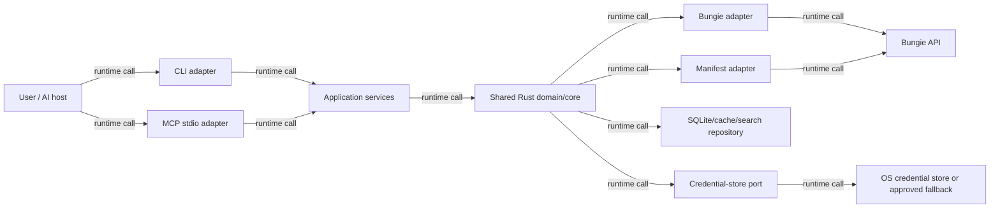

# Destiny MVP Architecture

This document turns the product vision into one implementable vertical slice: authenticate a local user, synchronize enough Manifest and profile data to understand inventory, search and inspect that inventory through CLI or MCP, and safely equip one item through CLI or MCP (with `move_item` remaining MCP-only). It uses `docs/integration-assumptions.md` as the external evidence boundary; provider facts and project decisions are kept distinct.

## 1. MVP decision and scope

### Goals

- Deliver a usable local Rust application with one shared application/core layer.
- Authenticate with a local Bungie **Public** OAuth client: system browser, one fixed exactly registered callback URI, random CSRF state, no client secret, and no refresh token.
- Synchronize Manifest definitions and the authenticated user's profile/inventory into a local cache and search index.
- Support inventory reads through CLI and MCP; support `ghostlink equip <ITEM> --character <CHARACTER>` and default-enabled MCP `equip_item` through the same application pipeline. `move_item` is MCP-only.
- Demonstrate the vertical journey: “Move The Last Word to my Warlock,” with semantic resolution, explicit-intent authorization for MCP, local projection validation, Bungie execution, acknowledgement, and freshness invalidation.

### Non-goals

Build engines, multi-item build plans/apply, plugs/mod/perk mutations, dismantling, locking, Postmaster, duplicate ranking, web UI, hosted service, confidential backend, and general-purpose Bungie proxy behavior are deferred. Single-item equip is current scope; weekly read capabilities have also landed. A backend may be evaluated later, but is not an MVP port or deployment assumption.

### Vertical journey

1. User runs a read command or invokes an MCP read tool; the core checks authorization and cache freshness.
2. If needed, the core launches the system browser and receives the registered callback. It validates `state`, stores the access token in the credential store, and never returns it to an adapter.
3. Manifest and profile synchronization populate local definitions and item projections.
4. User searches for “The Last Word”; the core resolves the semantic result to a stable item instance and destination character.
5. A move plan explains source, Vault intermediary if required, destination, and expected effects.
6. Explicit user intent authorizes one direct MCP `move_item` call (there is no CLI move command). The core refreshes the relevant profile immediately before execution, re-resolves the item, performs the minimum supported remote calls, refreshes afterward, and verifies the observed destination.
7. The adapter reports a semantic result or a safe, actionable error.

## 2. System context and boundaries



| Boundary | Responsibility | Must not do |
|---|---|---|
| Shared Rust core | Domain model, policy, freshness, planning, execution orchestration, typed outcomes | Render CLI/MCP formats or expose credentials |
| Application services | Use-case commands and queries over core ports | Contain transport-specific logic |
| Bungie adapter | OAuth callback exchange and authenticated API requests | Persist secrets in SQLite or log request headers |
| Manifest adapter | Download, validate, version, and normalize definitions | Treat definitions as live account state |
| SQLite/cache/search repository | Durable non-secret projections, indexes, sync metadata, plans/results | Store access tokens, API keys, authorization codes, or raw secret-bearing payloads |
| Credential-store port | Save/load/delete opaque access-token material securely | Define a particular library or print credentials |
| CLI adapter | Parse commands, display bounded results, request interactive confirmation | Reimplement policy or call Bungie directly |
| MCP stdio adapter | Expose semantic read tools and the intent-authorized mutation entry point | Put secrets in tool inputs/outputs or bypass semantic resolution, preflight, or mutation policy |

### Dependency direction

The diagram arrows depict runtime calls, not source-code dependency direction. In source code, `CLI` and `MCP` depend on application-service interfaces only. Application services depend inward on domain types and ports. Bungie, Manifest, SQLite, credential-store, terminal, and MCP implementations depend inward through core-owned ports; the domain never depends on an adapter. Both adapters therefore execute the same search, planning, authorization, freshness, and mutation policy.

## 3. Minimal domain model and ports

Stable external identifiers are opaque newtypes, not user-facing strings: `MembershipId`, `MembershipType`, `CharacterId`, `ItemInstanceId`, `ItemHash`, `BucketHash`, `DefinitionVersion`, and `SyncRevision`. `SyncRevision` is a repository-generated opaque, monotonically increasing revision assigned to each successfully committed normalized snapshot replacement. An unchanged sync may retain the existing revision when the normalized content hash is unchanged. A plan binds to the revision covering its selected item's state. `ItemHash` identifies a definition; `ItemInstanceId` identifies the user's concrete item. `CharacterId` and `MembershipId` are required for mutation targeting. `ItemLocation` is `Vault | Character(CharacterId) | Other(String)` with unknown locations preserved rather than guessed.

Core records include:

- `Character { id, class, race, gender, light, name? }`;
- `Item { instance_id, item_hash, location, quantity, equipped, locked, power, sockets/perks summary, updated_at }`;
- `ItemDefinition { hash, name, item_type, tier, element?, tags, definition_version }`;
- `InventorySnapshot { membership, revision, fetched_at, source, characters, items }`;
- `Freshness { dataset, fetched_at, revision, status }`; and
- `MovePlan { plan_id, item, source, destination, steps, created_at, expires_at }`.

Architectural ports are intentionally behavioral: `BungieGateway` authenticates and reads/executes supported operations; `ManifestGateway` obtains a versioned definition set; `InventoryRepository` reads/replaces projections and sync metadata transactionally; `CredentialStore` protects opaque access state; `Clock` and `IdGenerator` make expiry and idempotency testable; `MutationPolicy` enforces semantic resolution, ambiguity rejection, preflight, and verification; `SearchRepository` resolves semantic queries to indexed items. Exact Rust traits and endpoint mappings belong to implementation planning.

## 4. Authentication and secret boundaries

The MVP registers exactly one case-sensitive callback URI and treats it as configuration that must equal Bungie's registration. The system browser opens Bungie's authorization endpoint. The callback handler accepts a one-time authorization code only when the returned `state` matches a cryptographically random, short-lived pending authorization record. The token request sends `client_id` and code, never `client_secret`; `scope` is omitted as required by the documented integration behavior ([integration assumptions](integration-assumptions.md)).

```text
signed_out → authorizing → authorized
                    ├── cancelled/denied → signed_out
                    ├── state mismatch → auth_error
                    └── exchange failure → auth_error
authorized + 401/expired → reauthorization_required → authorizing
```

A public client receives no refresh token under the documented behavior. Expiry or rejection therefore produces an explicit `reauthorization_required` outcome and requires interactive login; the core must not silently retry indefinitely. Logout deletes the credential-store entry and local account projections as a separate explicit action. No confidential backend is implemented.

Access tokens, authorization codes, API keys, callback query values, and raw credential responses must not enter SQLite, logs, MCP payloads, model context, exception text, or normal command output. The Bungie adapter attaches bearer and `X-API-Key` headers internally. The API key is deployment configuration, not a user secret returned by the core.

`CredentialStore` is an abstraction. The preferred implementation uses an OS credential store selected during implementation after platform validation. If unavailable, the MVP must fail closed by default; an explicitly enabled fallback may store an opaque credential only in a user-restricted local mechanism, with a warning and platform-specific hardening documented at implementation time. It must never silently write plaintext credentials, SQLite rows, shell history, or config files. The architecture does not assert an unverified library.

## 5. Synchronization and persistence

Bungie remains the source of truth. SQLite contains a rebuildable cache/search projection, not an authority. Manifest data is synchronized by version: download to temporary storage, validate completeness and version, then replace definitions in one transaction. Profile synchronization fetches the required profile/components, normalizes them, and atomically replaces the affected snapshot plus `fetched_at`, `SyncRevision`, source, and schema version.

Freshness is dataset-specific (Manifest, profile, character inventory) and policy-driven rather than a single global TTL. Reads may use a fresh projection; stale or missing data triggers synchronization before answering. A forced `sync` bypasses freshness. Move, single-item equip and lock/unlock dispatch from the committed local projection after ordinary sync, acquiring only when missing, stale or invalidated; other mutations retain forced preflight. Bungie is the final validator. Acknowledged move/equip effects and lock state update the projection locally without a post-action read, advance its revision when content changes, and retain freshness on complete success. Incomplete, rejected or uncertain attempts invalidate freshness. Local persistence failure after acknowledgement preserves receipts and invalidates freshness without retrying Bungie; the next ordinary read syncs. Concurrent syncs use a per-dataset lock or equivalent single-flight policy; an interrupted transaction leaves the prior committed snapshot intact.

### Profile minted-time guard (slice A)

Ordinary sync compares Bungie's `Response.responseMintedTimestamp` with the
active profile's persisted minted instant, after requested-membership validation
and before definition filtering or publication. For the same membership ID and
type, when both instants are present, an older or equal candidate is discarded
(including its runtime bucket observations). The retained projection, acknowledged
effects, revision, minted instant, `checked_at`, and invalidation flag stay unchanged.
`DiscardedNotNewer` is a successful non-publication outcome, not an error or fresh
acquisition; the observation route uses its existing skip shape with `discarded:
true` and no observation pair.

Callers proceed with the retained projection for this call and report its actual
freshness. A stale projection remains stale, so a later Ordinary call may fetch
again. No retry loop or fabricated freshness evidence is introduced.

Missing minted evidence on either side, or an account switch, preserves normal
publication. Successful publication atomically stores the supplied instant (or
clears it when missing) with the SQLite profile row; effects and invalidation do
not change it. Minted time is acquisition metadata, excluded from normalized
content/revision identity, and is not a TTL timestamp. The core stores signed Unix
seconds plus nanoseconds; the adapter parses RFC 3339 instants with timezone
normalization, never orders raw strings. Minted time is ordering evidence only:
missing fields, malformed values, leap seconds and fractions beyond nanosecond
precision are treated as unknown (as DIM does), so the profile publishes and the
sync never fails because of this field.

**Temporary scope:** Forced, Preflight and PostAction acquisitions still publish
even older/equal minted profiles and store their supplied instant. Stack pulls and
loadout application retain that behavior pending their local-sync slices.
Instanced pulls now use Ordinary sync and inherit the guard. Their capacity is
advisory: definition-bucket character occupancy (including equipped) against
pinned audited constants, without remote Manifest evidence. Known full refuses;
unknown definitions allow Bungie to decide. Numeric error 1642 is destination full.
Acknowledged pulls persist locally, advance revision and retain freshness;
incomplete attempts and persistence failures invalidate, retaining receipts. This is not yet a global
monotonic-profile guarantee.

Repeated syncs are idempotent at the projection level: the same Bungie state produces the same normalized rows and revision semantics. A successful replacement with changed normalized content receives the next repository-generated `SyncRevision`; unchanged normalized content may retain its revision. Remote mutations are not assumed globally idempotent. Each plan has a local `plan_id`, a bounded step identity, and an execution record so retries can re-read current state and avoid replaying a step whose postcondition is already true. Never claim atomicity across multiple Bungie calls.

## 6. Read workflows

**Inventory search:** authorize; require a fresh-enough inventory projection; synchronize if needed; resolve query text through Manifest definitions and indexed fields; return semantic summaries with item instance IDs only where needed for follow-up, never raw API payloads. Ambiguous matches return candidates and ask the user to choose. `inspect_item` reads the selected projection and reports its current freshness marker.

**Build/loadout planning:** the MVP exposes only the architectural seam, not a build engine. A future planner may consume a fresh `InventorySnapshot` and Manifest definitions to produce a non-executable plan. No build optimization, substitution, or multi-item execution is accepted as MVP behavior.

## 7. Mutation workflow

1. **Resolve and plan internally:** resolve item and destination semantically; reject ambiguity; validate supported location rules; create a short-lived move/equip plan without remote mutation. Equip requires an explicit character, refuses equipped-elsewhere/class/exotic conflicts, and never guesses.
2. **Authorization:** one CLI equip invocation or MCP `equip_item`/`move_item` call is intent authorization. No preview, confirmation token/value, approval ceremony, or two-step protocol is required.
3. **Local validation (move and single equip):** ordinary sync acquires only missing, stale or invalidated state. Re-resolve the item and location against the current committed projection; check expiry, membership, revision binding, request selectors, source/destination, applicable safety constraints and no-op state. A changed binding refuses dispatch. Bungie remains the final validator. Other actions retain forced preflight.
4. **Execution:** call the minimum Bungie operations, using Vault as an intermediate only when required by Bungie semantics. Record step outcomes without recording secrets.
5. **Partial failure:** stop on an unsafe failure, report completed and uncompleted steps, and do not claim rollback or atomicity. A retry must refresh and re-plan.
6. **Acknowledgement (optimistic success):** when Bungie acknowledges every planned step, the outcome is `applied`. The profile is not re-read after the action, because Bungie's profile lags behind accepted actions and a post-action read reported false failures.
7. **Freshness invalidation:** after any dispatched attempt the local projection is durably marked invalidated, so the next ordinary read forces a provider sync. If that local update fails, the outcome fails closed instead of claiming `applied`.

Refused, uncertain and partially executed attempts are never `applied`. No polling or retries are added.

### MCP mutation contract

MCP move and equip execution are enabled by default and authorized by explicit user intent. The MCP adapter exposes `move_item` and `equip_item`. The tool resolves the item and destination, rejects ambiguity, creates any internal short-lived plan, validates against the committed local projection under ordinary sync, executes the minimum supported remote calls, and reports receipts and partial failure honestly without post-action acquisition.

There is no mandatory preview, confirmation token/value, CLI approval, local web approval, host confirmation ceremony, or two-step MCP protocol. The MCP adapter does not infer authority from vague or ambiguous input: explicit user intent to move an identified item to a destination is sufficient, while semantic resolution and ambiguity rejection remain mandatory. CLI equip uses the same ordinary-sync, local-validation, execution and acknowledgement path as MCP equip. `destiny-output` owns their exact shared JSON projection; CLI text and exit codes remain process-specific. Equip uses an exact EquipItem-only endpoint adapter; transfer remains transfer-only. Bungie requires orbit, social space, or offline state; no activity pre-check is implemented. Transfers may succeed before equip refuses, with no rollback or blind retry. Offline fixtures establish pipeline behavior, not live-account success.

## 8. Errors, retries, and observability

The taxonomy is stable and adapter-neutral: `authorization_required`, `reauthorization_required`, `authorization_denied`, `csrf_state_mismatch`, `credential_store_unavailable`, `provider_authentication`, `provider_rate_limit`, `provider_unavailable`, `provider_validation`, `stale_state`, `ambiguous_match`, `unsupported_operation`, `partial_failure`, `verification_failed`, `local_storage`, and `configuration_error`.

Retry only transient transport, provider-unavailable, and rate-limit outcomes, with bounded exponential backoff and provider-aware limits. Do not retry authorization, validation, ambiguity, or verification failures automatically. Before retrying a mutation, refresh and check the step postcondition. Correlation IDs and plan/step IDs support diagnosis; logs contain event type, timing, dataset, status, retry count, and redacted provider status. Never log URLs containing codes, headers, tokens, full payloads, or user-identifying data unless explicitly redacted and required for local debugging.

## 9. Threat model and trust boundaries

The user and Bungie are external trust boundaries. The system browser is trusted for user interaction but not for callback input; callback state and code validation protect against CSRF and unsolicited callbacks. The MCP host/model is untrusted with respect to credentials and mutation authority. SQLite is local but inspectable and therefore receives only non-secret projections. The OS credential store is the preferred secret boundary. Threats include malicious callback requests, state fixation, token leakage through diagnostics, stale-state destructive actions, prompt-injected mutation requests, and local-disk exposure. Mitigations are exact callback matching, one-time random state, no secrets in model-visible channels, semantic resolution with ambiguity rejection, mandatory fresh preflight, single-call intent-authorized MCP mutation, restricted fallback policy, and acknowledgement-only success with durable freshness invalidation.

## 10. Configuration and deployment

The MVP is a local native process with a user-configured Bungie API key, public OAuth client ID, and callback URI. The callback URI is required configuration and is parsed into its exact scheme, host, port, and path. Startup validates it against the separately configured registered URI value; the callback listener binds that exact host and port and fails closed if unavailable. Packaged environments must separately register the exact URI and provide the matching application configuration. No dynamic port, wildcard, custom scheme, or PKCE support is assumed because the evidence does not establish those guarantees. The application uses system-browser authorization and local SQLite/cache paths selected by platform conventions. The selected `rmcp` 1.x version and feature set must be revalidated and pinned during implementation; the research artifact records the 1.5.0 evidence snapshot, not an eternal guarantee.

## 11. Adapter capabilities and result shapes

The CLI is the operator-facing adapter. Its commands map one-to-one to application use cases, print concise human-readable summaries, and return non-zero status for typed failures. It may offer `--json` for scripting, but the JSON shape is a sanitized application result, not a Bungie response. Interactive authorization and confirmation are CLI concerns delegated to core policy inputs; the CLI never receives a token.

The MCP adapter is a server-side stdio process. Its tools include inventory reads, `move_item`, and `equip_item`. Tool arguments are semantic names, destination, and bounded intent—not endpoint parameters or approval artifacts. Results contain definitions, locations, freshness markers, bounded action effects, and typed error codes. They do not contain headers, authorization URLs with secrets, authorization codes, tokens, API keys, or unbounded upstream payloads.

| Capability | CLI | MCP default | Shared service |
|---|---:|---:|---|
| Authenticate / reauthorize | yes, interactive | reports `reauthorization_required` | authorization service |
| Sync Manifest/profile | yes | implicit when policy requires | synchronization service |
| List/search/inspect | yes | yes | inventory query service |
| Move planning | internal/optional UX | internal to `move_item` | mutation planning service |
| Execute move | no | yes, one direct intent-authorized call | mutation policy and executor |
| Equip one item | yes, explicit character required | yes, explicit item and character required | shared equip planner/executor and JSON projection |
| Raw Bungie request | no | no | never exposed |

Every use case returns either a typed success containing sanitized domain records and freshness, or a typed failure from the shared taxonomy. Adapters may translate wording and exit/status conventions, but cannot reinterpret a non-acknowledged or partial mutation as success. Mutation actions use CLI exit 0 for `applied` or a fresh no-op, 41 for refused, uncertain or partial attempts, and 42 when local state could not be updated after an acknowledged action; MCP reports every non-success as `isError=true`.

## 12. Operational invariants

The following invariants are implementation acceptance rules, not optional optimizations:

1. A query never presents a stale projection as current; it includes freshness or synchronizes first.
2. A mutation never trusts a plan past its expiry. Move and single equip validate the current committed projection under ordinary sync; other actions retain forced preflight.
3. A mutation never selects an item by display name alone; names resolve to an explicit instance or an ambiguity result.
4. A failed postcondition never becomes a successful action merely because the provider returned HTTP success.
5. Local replacement transactions preserve the previous committed snapshot until the new one is complete.
6. Reauthorization is surfaced to the caller rather than hidden behind repeated transport retries.
7. All application paths use the same policy service, regardless of whether the request came from terminal input or an MCP host.
8. MCP execution requires explicit user intent plus semantic resolution, ambiguity rejection, and shared mutation validation; adapters cannot bypass local revision binding or the ordinary freshness gate for move/single equip.
9. Secret-bearing values are opaque at the application boundary and are unavailable to presentation serializers.

A synchronization run records dataset, requested reason (`stale`, `forced`, `preflight`, or `post_action`), start/end time, source revision when available, and outcome. These are operational markers only. A sync marker does not imply the remote state is immutable or that an unrelated dataset is fresh.

A move plan is valid only for its selected membership, item instance, destination, source `SyncRevision`, and expiry window. If any of these assumptions change during preflight, execution stops with `stale_state`; the service reports that the action must be re-resolved. This prevents stale state from authorizing a mutation without imposing a second MCP approval step.

## 13. Implementation seams and sequence

Implementation should proceed in vertical slices that preserve a runnable path:

1. Establish configuration, sanitized diagnostics, domain IDs, ports, and credential-store capability detection.
2. Implement the authorization state machine and a fakeable callback/token exchange boundary; prove denial, state mismatch, expiry, and reauthorization outcomes without a live account.
3. Add Manifest versioning and transactional replacement, then profile normalization and freshness metadata.
4. Build repository-backed character listing, semantic inventory search, and inspection against fixture snapshots.
5. Wire the CLI to the application services and exercise the read journey end to end.
6. Add internal move/equip planning, preflight refresh, remote execution boundaries, post-action refresh, and destination/equipped-state verification using Bungie adapter test doubles.
7. Add the MCP stdio adapter, including the single-call intent-authorized `move_item` contract, over the same service instances and compare its results with CLI results.

Each slice should test the port boundary rather than couple domain tests to HTTP, SQLite implementation details, or a particular credential-store library. Live Bungie testing is a separate integration check and must use a non-production account where possible. The first implementation plan should turn the open questions below into explicit decisions before adding endpoint-specific code.

## 14. Acceptance criteria

- [ ] A fresh local user can authenticate through the system browser using the exact registered callback and public-client exchange; no secret or refresh token is required.
- [ ] CSRF state mismatch, denial, expiry, and 401 each produce the specified typed outcome, with 401/expiry reaching `reauthorization_required`.
- [ ] Manifest and profile snapshots expose freshness, revision, and source markers and commit atomically.
- [ ] CLI equip and MCP equip return identical JSON through shared presentation and application services; MCP move remains a separate one-call intent-authorized tool.
- [ ] Search and inspect resolve a concrete item instance and distinguish definition hash from instance ID.
- [ ] `move_item` resolves semantically, rejects ambiguity, applies CLI UX if used, refreshes before execution, handles partial failure honestly, refreshes afterward, and verifies destination.
- [ ] MCP move execution is enabled by default through one direct intent-authorized `move_item` call; it has no mandatory preview, confirmation token/value, approval ceremony, or two-step protocol, and cannot bypass the shared policy service.
- [ ] Secret scanning of logs, SQLite, MCP results, and command output finds no access token, API key, code, or refresh token.
- [ ] A repeatable end-to-end test demonstrates the vertical journey, including one direct intent-authorized MCP mutation, without claiming multi-call atomicity.

## 15. Deferred implementation questions

- Which platforms and OS credential stores are first-class, and what approved restricted fallback exists for each?
- What exact callback URI values are registered for development and packaged release environments, and how are those exact values provisioned into application configuration?
- Which Bungie profile components and transfer endpoint sequence are sufficient for the first supported move?
- What rate-limit headers and provider error fields can be safely normalized?
- Which exact `rmcp` version/features pass implementation-time compatibility checks?
- What user-facing CLI confirmation UX is useful, while preserving explicit user intent as the sole MCP mutation authorization?
- What dataset TTLs and synchronization concurrency limits are appropriate after observing real response sizes and latency?
- Which privacy-preserving account identifiers, if any, may appear in local diagnostics?
