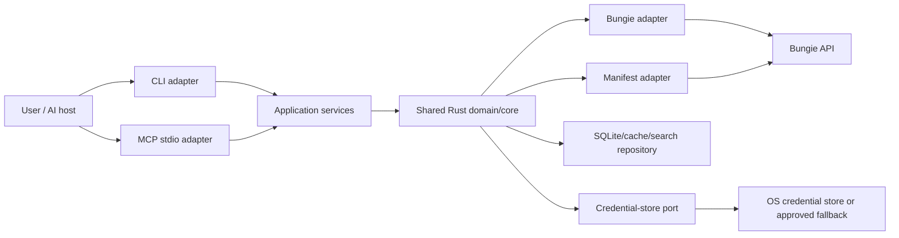

# Destiny MVP Architecture

This document turns the product vision into one implementable vertical slice: authenticate a local user, synchronize enough Manifest and profile data to understand inventory, search and inspect that inventory through CLI or MCP, and safely move one item through the CLI. It uses `docs/integration-assumptions.md` as the external evidence boundary; provider facts and project decisions are kept distinct.

## 1. MVP decision and scope

### Goals

- Deliver a usable local Rust application with one shared application/core layer.
- Authenticate with a local Bungie **Public** OAuth client: system browser, one fixed exactly registered callback URI, random CSRF state, no client secret, and no refresh token.
- Synchronize Manifest definitions and the authenticated user's profile/inventory into a local cache and search index.
- Support `list_characters`, `search_inventory`, and `inspect_item` through both CLI and MCP; support previewed, confirmed `move_item` execution through CLI only.
- Demonstrate the vertical journey: “Move The Last Word to my Warlock,” with preview, confirmation, fresh preflight, Bungie execution, refresh, and verification.

### Non-goals

World State/weekly rotation, equip/build engines, multi-item build plans, dismantling, locking, Postmaster, duplicate ranking, web UI, hosted service, confidential backend, and general-purpose Bungie proxy behavior are deferred. A backend may be evaluated later, but is not an MVP port or deployment assumption.

### Vertical journey

1. User runs a read command or invokes an MCP read tool; the core checks authorization and cache freshness.
2. If needed, the core launches the system browser and receives the registered callback. It validates `state`, stores the access token in the credential store, and never returns it to an adapter.
3. Manifest and profile synchronization populate local definitions and item projections.
4. User searches for “The Last Word”; the core resolves the semantic result to a stable item instance and destination character.
5. A move plan explains source, Vault intermediary if required, destination, and expected effects.
6. The user explicitly confirms. The core refreshes the relevant profile immediately before execution, re-resolves the item, performs supported remote calls, refreshes afterward, and verifies the observed destination.
7. The adapter reports a semantic result or a safe, actionable error.

## 2. System context and boundaries



| Boundary | Responsibility | Must not do |
|---|---|---|
| Shared Rust core | Domain model, policy, freshness, planning, execution orchestration, typed outcomes | Render CLI/MCP formats or expose credentials |
| Application services | Use-case commands and queries over core ports | Contain transport-specific logic |
| Bungie adapter | OAuth callback exchange and authenticated API requests | Persist secrets in SQLite or log request headers |
| Manifest adapter | Download, validate, version, and normalize definitions | Treat definitions as live account state |
| SQLite/cache/search repository | Durable non-secret projections, indexes, sync metadata, plans/results | Store access tokens, API keys, authorization codes, or raw secret-bearing payloads |
| Credential-store port | Save/load/delete opaque access-token material securely | Define a particular library or print credentials |
| CLI adapter | Parse commands, display bounded results, request interactive confirmation | Reimplement policy or call Bungie directly |
| MCP stdio adapter | Expose semantic read tools and safe mutation entry points | Put secrets in tool inputs/outputs or bypass confirmation/policy |

### Dependency direction

`CLI` and `MCP` depend on application-service interfaces only. Application services depend inward on domain types and ports. Bungie, Manifest, SQLite, credential-store, terminal, and MCP implementations depend inward on those ports; the domain never depends on an adapter. Both adapters therefore execute the same search, planning, authorization, freshness, and mutation policy.

## 3. Minimal domain model and ports

Stable external identifiers are opaque newtypes, not user-facing strings: `MembershipId`, `MembershipType`, `CharacterId`, `ItemInstanceId`, `ItemHash`, `BucketHash`, `DefinitionVersion`, and `SyncRevision`. `ItemHash` identifies a definition; `ItemInstanceId` identifies the user's concrete item. `CharacterId` and `MembershipId` are required for mutation targeting. `ItemLocation` is `Vault | Character(CharacterId) | Other(String)` with unknown locations preserved rather than guessed.

Core records include:

- `Character { id, class, race, gender, light, name? }`;
- `Item { instance_id, item_hash, location, quantity, equipped, locked, power, sockets/perks summary, updated_at }`;
- `ItemDefinition { hash, name, item_type, tier, element?, tags, definition_version }`;
- `InventorySnapshot { membership, revision, fetched_at, source, characters, items }`;
- `Freshness { dataset, fetched_at, revision, status }`; and
- `MovePlan { plan_id, item, source, destination, steps, created_at, expires_at }`.

Architectural ports are intentionally behavioral: `BungieGateway` authenticates and reads/executes supported operations; `ManifestGateway` obtains a versioned definition set; `InventoryRepository` reads/replaces projections and sync metadata transactionally; `CredentialStore` protects opaque access state; `Clock` and `IdGenerator` make expiry and idempotency testable; `ConfirmationPolicy` decides whether an explicit confirmation is present and valid; `SearchRepository` resolves semantic queries to indexed items. Exact Rust traits and endpoint mappings belong to implementation planning.

## 4. Authentication and secret boundaries

The MVP registers exactly one case-sensitive callback URI and treats it as configuration that must equal Bungie's registration. The system browser opens Bungie's authorization endpoint. The callback handler accepts a one-time authorization code only when the returned `state` matches a cryptographically random, short-lived pending authorization record. The token request sends `client_id` and code, never `client_secret`; `scope` is omitted as required by the documented integration behavior ([integration assumptions](integration-assumptions.md)).

```text
signed_out → authorizing → authorized
                    ├── cancelled/denied → signed_out
                    ├── state mismatch → auth_error
                    └── exchange failure → auth_error
authorized + 401/expired → reauthorization_required → authorizing
```

A public client receives no refresh token under the documented behavior. Expiry or rejection therefore produces an explicit `reauthorization_required` outcome and requires interactive login; the core must not silently retry indefinitely. Logout deletes the credential-store entry and local account projections as a separate explicit action. No confidential backend is implemented.

Access tokens, authorization codes, API keys, callback query values, and raw credential responses must not enter SQLite, logs, MCP payloads, model context, exception text, or normal command output. The Bungie adapter attaches bearer and `X-API-Key` headers internally. The API key is deployment configuration, not a user secret returned by the core.

`CredentialStore` is an abstraction. The preferred implementation uses an OS credential store selected during implementation after platform validation. If unavailable, the MVP must fail closed by default; an explicitly enabled fallback may store an opaque credential only in a user-restricted local mechanism, with a warning and platform-specific hardening documented at implementation time. It must never silently write plaintext credentials, SQLite rows, shell history, or config files. The architecture does not assert an unverified library.

## 5. Synchronization and persistence

Bungie remains the source of truth. SQLite contains a rebuildable cache/search projection, not an authority. Manifest data is synchronized by version: download to temporary storage, validate completeness and version, then replace definitions in one transaction. Profile synchronization fetches the required profile/components, normalizes them, and atomically replaces the affected snapshot plus `fetched_at`, `SyncRevision`, source, and schema version.

Freshness is dataset-specific (Manifest, profile, character inventory) and policy-driven rather than a single global TTL. Reads may use a fresh projection; stale or missing data triggers synchronization before answering. A forced `sync` bypasses freshness. A mutation always performs a mandatory preflight refresh regardless of TTL, and post-action refresh is required before verification. Concurrent syncs use a per-dataset lock or equivalent single-flight policy; an interrupted transaction leaves the prior committed snapshot intact.

Repeated syncs are idempotent at the projection level: the same Bungie state produces the same normalized rows and revision semantics. Remote mutations are not assumed globally idempotent. Each plan has a local `plan_id`, a bounded step identity, and an execution record so retries can re-read current state and avoid replaying a step whose postcondition is already true. Never claim atomicity across multiple Bungie calls.

## 6. Read workflows

**Inventory search:** authorize; require a fresh-enough inventory projection; synchronize if needed; resolve query text through Manifest definitions and indexed fields; return semantic summaries with item instance IDs only where needed for follow-up, never raw API payloads. Ambiguous matches return candidates and ask the user to choose. `inspect_item` reads the selected projection and reports its current freshness marker.

**Build/loadout planning:** the MVP exposes only the architectural seam, not a build engine. A future planner may consume a fresh `InventorySnapshot` and Manifest definitions to produce a non-executable plan. No build optimization, substitution, or multi-item execution is accepted as MVP behavior.

## 7. Mutation workflow

1. **Plan/preview:** resolve item and destination; validate supported location rules; produce a human-readable `MovePlan` with no remote mutation.
2. **Explicit confirmation:** require a deliberate CLI confirmation or an equivalent policy-approved interaction. A natural-language request alone is not confirmation.
3. **Mandatory preflight refresh:** fetch current profile state, re-resolve the item by stable identity, re-check destination, lock/availability and other applicable constraints, and invalidate the plan if assumptions changed.
4. **Execution:** call the minimum Bungie operations, using Vault as an intermediate only when required by Bungie semantics. Record step outcomes without recording secrets.
5. **Partial failure:** stop on an unsafe failure, report completed and uncompleted steps, and do not claim rollback or atomicity. A retry must refresh and re-plan.
6. **Post-action refresh:** fetch the affected profile/components and commit the resulting projection.
7. **Verification:** require the item to be observed at the requested destination; return `verified`, `partial_failure`, or a typed failure.

MCP mutation tools are disabled by default in the MVP. Read-only MCP tools are enabled; a future opt-in mutation mode must invoke the same plan, confirmation policy, preflight, execution, and verification service as CLI, never a separate MCP shortcut. This is safer for model-mediated calls and aligns the MVP with the source vision without granting an unreviewed agent write authority.

## 8. Errors, retries, and observability

The taxonomy is stable and adapter-neutral: `authorization_required`, `reauthorization_required`, `authorization_denied`, `csrf_state_mismatch`, `credential_store_unavailable`, `provider_authentication`, `provider_rate_limit`, `provider_unavailable`, `provider_validation`, `stale_state`, `ambiguous_match`, `unsupported_operation`, `partial_failure`, `verification_failed`, `local_storage`, and `configuration_error`.

Retry only transient transport, provider-unavailable, and rate-limit outcomes, with bounded exponential backoff and provider-aware limits. Do not retry authorization, validation, ambiguity, confirmation, or verification failures automatically. Before retrying a mutation, refresh and check the step postcondition. Correlation IDs and plan/step IDs support diagnosis; logs contain event type, timing, dataset, status, retry count, and redacted provider status. Never log URLs containing codes, headers, tokens, full payloads, or user-identifying data unless explicitly redacted and required for local debugging.

## 9. Threat model and trust boundaries

The user and Bungie are external trust boundaries. The system browser is trusted for user interaction but not for callback input; callback state and code validation protect against CSRF and unsolicited callbacks. The MCP host/model is untrusted with respect to credentials and mutation authority. SQLite is local but inspectable and therefore receives only non-secret projections. The OS credential store is the preferred secret boundary. Threats include malicious callback requests, state fixation, token leakage through diagnostics, stale-state destructive actions, prompt-injected mutation requests, and local-disk exposure. Mitigations are exact callback matching, one-time random state, no secrets in model-visible channels, mandatory preflight/confirmation, least-privilege read-only MCP default, restricted fallback policy, and post-action verification.

## 10. Configuration and deployment

The MVP is a local native process with a user-configured Bungie API key, public OAuth client ID, and fixed callback URI. The callback URI is configurable only as a whole exact value and must be validated against the registered value at startup; no wildcard, dynamic port, custom scheme, or PKCE behavior is assumed because the evidence does not establish those guarantees. The application uses system-browser authorization and local SQLite/cache paths selected by platform conventions. The selected `rmcp` 1.x version and feature set must be revalidated and pinned during implementation; the research artifact records the 1.5.0 evidence snapshot, not an eternal guarantee.

## 11. Adapter capabilities and result shapes

The CLI is the operator-facing adapter. Its commands map one-to-one to application use cases, print concise human-readable summaries, and return non-zero status for typed failures. It may offer `--json` for scripting, but the JSON shape is a sanitized application result, not a Bungie response. Interactive authorization and confirmation are CLI concerns delegated to core policy inputs; the CLI never receives a token.

The MCP adapter is a server-side stdio process. Its initial tools are `list_characters`, `search_inventory`, and `inspect_item`; an explicit `preview_move_item` may be exposed as read-only planning. Tool arguments are semantic names and filters, not endpoint parameters. Results contain definitions, locations, freshness markers, and bounded error codes. They do not contain headers, authorization URLs with secrets, authorization codes, tokens, API keys, or unbounded upstream payloads.

| Capability | CLI | MCP default | Shared service |
|---|---:|---:|---|
| Authenticate / reauthorize | yes, interactive | reports `reauthorization_required` | authorization service |
| Sync Manifest/profile | yes | implicit when policy requires | synchronization service |
| List/search/inspect | yes | yes | inventory query service |
| Preview move | yes | optional read-only tool | mutation planning service |
| Execute move | yes with confirmation | disabled | mutation policy and executor |
| Raw Bungie request | no | no | never exposed |

Every use case returns either a typed success containing sanitized domain records and freshness, or a typed failure from the shared taxonomy. Adapters may translate wording and exit/status conventions, but cannot reinterpret a successful remote mutation or downgrade `verification_failed` to success.

## 12. Operational invariants

The following invariants are implementation acceptance rules, not optional optimizations:

1. A query never presents a stale projection as current; it includes freshness or synchronizes first.
2. A mutation never trusts a plan past its expiry or skips its mandatory preflight refresh.
3. A mutation never selects an item by display name alone; names resolve to an explicit instance or an ambiguity result.
4. A failed postcondition never becomes a successful action merely because the provider returned HTTP success.
5. Local replacement transactions preserve the previous committed snapshot until the new one is complete.
6. Reauthorization is surfaced to the caller rather than hidden behind repeated transport retries.
7. All application paths use the same policy service, regardless of whether the request came from terminal input or an MCP host.
8. Secret-bearing values are opaque at the application boundary and are unavailable to presentation serializers.

A synchronization run records dataset, requested reason (`stale`, `forced`, `preflight`, or `post_action`), start/end time, source revision when available, and outcome. These are operational markers only. A sync marker does not imply the remote state is immutable or that an unrelated dataset is fresh.

A move plan is valid only for its selected membership, item instance, destination, source revision, and expiry window. If any changes during preflight, the plan becomes `stale_state`; the user must receive a new preview. This keeps human confirmation tied to the exact action being executed.

## 13. Implementation seams and sequence

Implementation should proceed in vertical slices that preserve a runnable path:

1. Establish configuration, sanitized diagnostics, domain IDs, ports, and credential-store capability detection.
2. Implement the authorization state machine and a fakeable callback/token exchange boundary; prove denial, state mismatch, expiry, and reauthorization outcomes without a live account.
3. Add Manifest versioning and transactional replacement, then profile normalization and freshness metadata.
4. Build repository-backed character listing, semantic inventory search, and inspection against fixture snapshots.
5. Wire the CLI to the application services and exercise the read journey end to end.
6. Add move planning, confirmation policy, preflight refresh, remote execution boundary, post-action refresh, and verification using a Bungie adapter test double.
7. Add the read-only MCP stdio adapter over the same service instances and compare its results with CLI results.

Each slice should test the port boundary rather than couple domain tests to HTTP, SQLite implementation details, or a particular credential-store library. Live Bungie testing is a separate integration check and must use a non-production account where possible. The first implementation plan should turn the open questions below into explicit decisions before adding endpoint-specific code.

## 14. Acceptance criteria

- [ ] A fresh local user can authenticate through the system browser using the exact registered callback and public-client exchange; no secret or refresh token is required.
- [ ] CSRF state mismatch, denial, expiry, and 401 each produce the specified typed outcome, with 401/expiry reaching `reauthorization_required`.
- [ ] Manifest and profile snapshots expose freshness, revision, and source markers and commit atomically.
- [ ] CLI and read-only MCP return equivalent results through shared application services.
- [ ] Search and inspect resolve a concrete item instance and distinguish definition hash from instance ID.
- [ ] `move_item` previews first, requires confirmation, refreshes before execution, handles partial failure honestly, refreshes afterward, and verifies destination.
- [ ] MCP mutation remains disabled by default and cannot bypass the shared policy service when later enabled.
- [ ] Secret scanning of logs, SQLite, MCP results, and command output finds no access token, API key, code, or refresh token.
- [ ] A repeatable end-to-end test demonstrates the vertical journey without claiming multi-call atomicity.

## 15. Deferred implementation questions

- Which platforms and OS credential stores are first-class, and what approved restricted fallback exists for each?
- What exact fixed callback URI is registered for development and packaged release environments?
- Which Bungie profile components and transfer endpoint sequence are sufficient for the first supported move?
- What rate-limit headers and provider error fields can be safely normalized?
- Which exact `rmcp` version/features pass implementation-time compatibility checks?
- What user-facing CLI confirmation and MCP-host opt-in protocol are acceptable for future mutations?
- What dataset TTLs and synchronization concurrency limits are appropriate after observing real response sizes and latency?
- Which privacy-preserving account identifiers, if any, may appear in local diagnostics?
